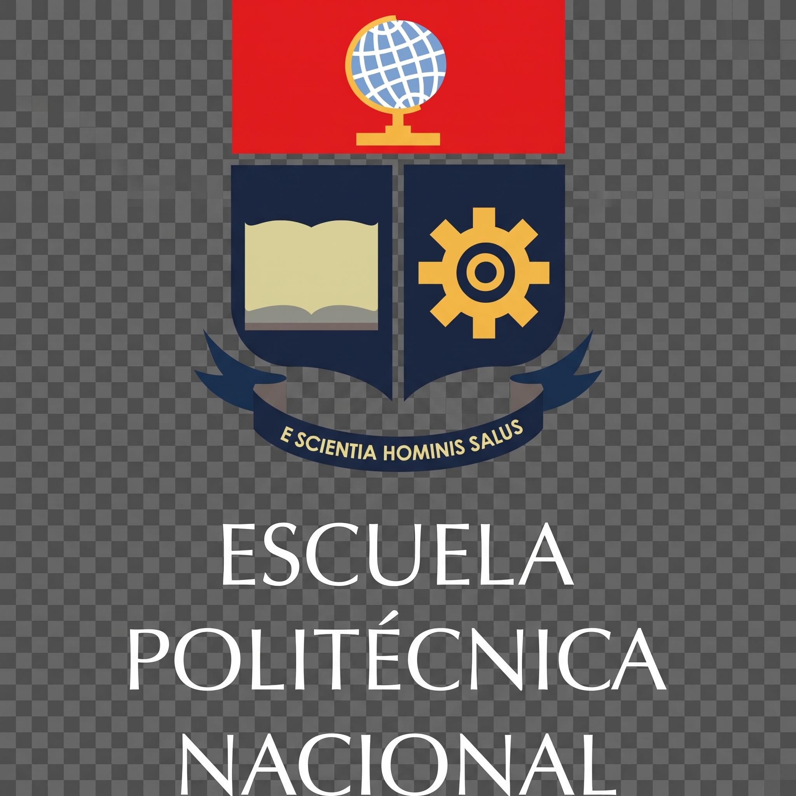

#

  

⚡ Portafolio de Sistemas Operativos

> **Análisis de arquitectura, administración de recursos y comparativa técnica Windows vs. GNU/Linux**

| | |
|---|---|
| **Estudiantes** | Nicolas Galán · Leonardo Vilañez |
| **Docente** | Ing. Rubén Rumipamba, Ph.D. |
| **Institución** | EPN · FIEEC |

---

## 📖 Descripción

Repositorio oficial de prácticas, scripts de automatización y documentación técnica de la asignatura **Sistemas Operativos**. Cada módulo semanal integra el estudio teórico-práctico del hardware y del núcleo del sistema operativo mediante herramientas nativas en **PowerShell** (Windows) y **Bash** (GNU/Linux).

## 📂 Contenido del repositorio por semanas

| Semana | Tema central | Scripts principales | Estado |
|---|---|---|---|
| 📂 **[`./Semana1`](./Semana1)** | Arquitectura de Computadoras e Inventario de Hardware | `inventario.ps1` · `inventario.sh` | 🟢 **Completado** |
| 📂 **[`./Semana2`](./Semana2)** | Jerarquía de Memoria, Caché y Representación de Datos | `memoria.ps1` · `memoria.sh` | 🟢 **Completado** |
| 📂 **[`./Semana3`](./Semana3)** | Departamentos del SO, Multiprogramación y Arranque | `informe_arranque.ps1` · `informe_arranque.sh` | 🟢 **Completado** |
| 📂 **[`./Semana4`](./Semana4)** | Procesos, Hilos y Planificación de CPU | *En desarrollo* | 🟡 **En curso** |

## 🖥️ Entornos de prueba

| Parámetro | Entorno Windows | Entorno GNU/Linux |
|---|---|---|
| **Nombre de nodo** | `DESKTOP-FIEECEC` | `fieecec-almalinux` |
| **Sistema Operativo** | Windows 11 Pro (64-bit) | AlmaLinux 9.4 (Seafoam Ocelot) |
| **Arquitectura** | `x86_64` / `AMD64` (*Little Endian*) | `x86_64` (*Little Endian*) |
| **Procesador** | Intel Core i7-11800H @ 2.30 GHz (8C / 16T) | Intel Core i7-11800H (Cachés L1d/L1i/L2/L3) |
| **Memoria RAM** | 15.8 GB físicos | 7.7 GiB asignados |

## 🤝 Uso ético de IA y registro de prompts

En cumplimiento con la política de transparencia académica, dejamos constancia del uso de Inteligencia Artificial como apoyo consultivo para la sintaxis de comandos, resolución de dudas en Git y diseño de plantillas en Markdown. Todo el código fue ejecutado, probado y verificado por el equipo.

- **Prompt 1 (Flujo de trabajo en Git):** *"Necesito inicializar un repositorio con los comandos del semestre en GitHub y sincronizar la rama main desde la terminal."*
- **Prompt 2 (Tablas comparativas):** *"Necesito una tabla comparativa con la funcionalidad, el comando en PowerShell, su equivalente en Bash y qué hace cada comando según la guía de clase."*
- **Prompt 3 (Estandarización de documentación):** *"Diseña el README de cada semana con tablas de variables, fórmulas matemáticas en LaTeX y ejemplos aplicados del laboratorio."*

## 👥 Autores

- **Nicolas Galán**
- **Leonardo Vilañez**

---

Escuela Politécnica Nacional · Facultad de Ingeniería Eléctrica y Electrónica (FIEEC)
